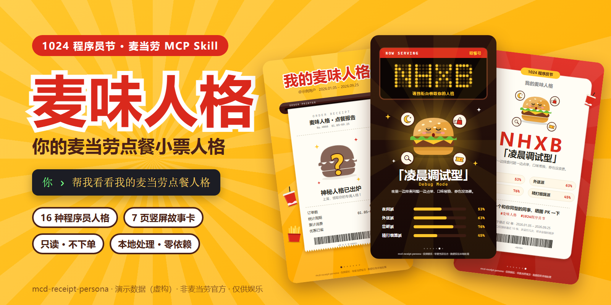
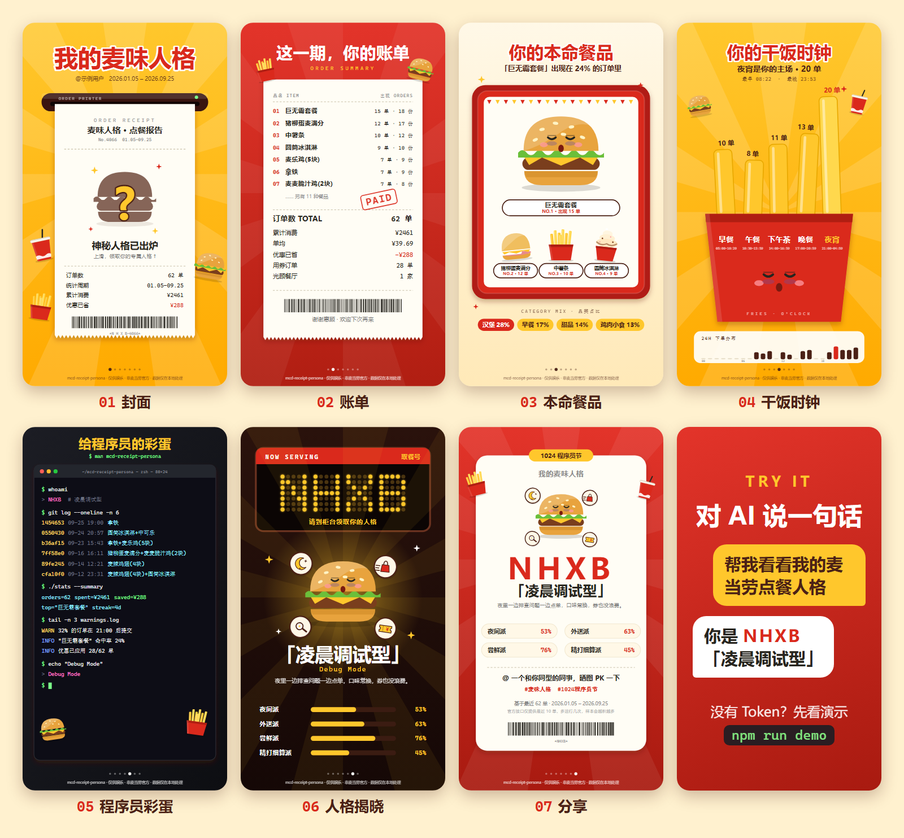
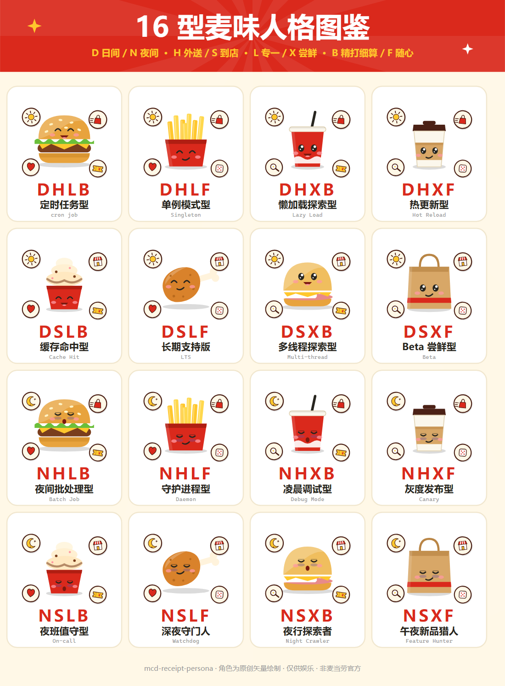

# 麦味人格 · mcd-receipt-persona

> 对 AI 说一句话，把你最近的麦当劳订单变成一套小票风故事卡：小票、餐盘、薯条盒、终端、取餐叫号屏，最后告诉你是 16 种程序员人格里的哪一种。
> 只读 · 本地处理 · 不会下单 · 为 **1024 程序员节** 而做

   

<p align="center">
  
</p>

<p align="center"><sub>↑ 全部由虚构的演示数据生成，不含任何真实订单</sub></p>

## 先试试（不需要 Token）

在仓库根目录运行：

```bash
npm run demo
```

用浏览器打开 `output/report.html` 上下翻页，或直接看 `output/pages/` 里的 7 张 PNG。

> 导出 PNG 会调用本机已安装的 Edge / Chrome / Chromium。没有浏览器时只是少了 PNG，SVG 和 HTML 照常生成。
> 不想用 npm 也行：`node skills/mcd-receipt-persona/scripts/wrapped.mjs --demo --out output --png`

## 它能做什么

对 AI 说：**"帮我看看我的麦当劳点餐人格"**，它会：

1. 通过麦当劳 MCP 读取你最近的订单（官方接口只提供最近 10 单，工具会把每次拿到的订单合并进本地历史，越用越准）；
2. 在本机脱敏并统计下单时段、就餐方式、常点餐品（会展开套餐里的真实餐品）、用券情况、连续下单天数；
3. 从 4 个维度推导出 16 种人格之一，用程序员熟悉的概念命名，例如 `NHXB`「凌晨调试型」、`DSLF`「长期支持版」；
4. 输出 7 页 9:16 的故事卡（SVG + PNG）、一张长图、一个可翻页的 `report.html` 和文字摘要 `summary.md`。

<p align="center">
  
</p>

和"一张人格卡"不同，这里每个结论都有自己的点餐场景：

| 页 | 场景 | 讲什么 |
|---|---|---|
| 01 封面 | 小票机吐出一张神秘小票 | 人格还是一个问号，只给订单数、统计周期、累计消费 |
| 02 账单 | 红底账单小票，盖「PAID」章 | 点过的餐品清单、订单数、累计消费、单均、省下的钱 |
| 03 本命餐品 | 餐盘 | 出现在最多订单里的餐品当主角，旁边是次爱餐品和品类占比 |
| 04 干饭时钟 | 薯条盒 | 五个时段各一根薯条，越高订单越多，下面是 24 小时分布 |
| 05 程序员彩蛋 | 终端 | `whoami`、`git log --oneline`（订单当 commit）、`warnings.log` |
| 06 人格揭晓 | 取餐叫号屏 | 点阵 LED 亮起人格代码，角色登场，四个维度各有强度条 |
| 07 分享 | 分享卡 | 人格代码、称号、角色，底部带话题标签和"@ 一个和你同型的同事" |

订单少也不会一片空白：没有的数据（比如优惠）对应的内容会自动省略，并列第一会如实写成"并列"，不会悄悄只挑一个。

## 16 种人格

四个维度各取一个字母，组成人格代码：

| 维度 | 字母 | 怎么判定 |
|---|---|---|
| 时段 | **D** 日间派 · **N** 夜间派 | 05:00–16:59 下单占比 ≥ 50% 为 D |
| 场景 | **H** 外送派 · **S** 到店派 | 麦乐送占"已标注就餐方式"订单的比例 ≥ 50% 为 H（到店 / 外带 / 得来速都算 S） |
| 口味 | **L** 专一派 · **X** 尝鲜派 | 最常点的餐品出现在 ≥ 35% 的订单里为 L |
| 价格 | **B** 精打细算派 · **F** 随心派 | 用券订单 ≥ 40%，或优惠占比 ≥ 12% 为 B |

<p align="center">
  
</p>

每个角色都由代码自动组合而成：**主体**是你最常点的那类食物（汉堡、薯条盒、可乐、咖啡、圣代、鸡腿、麦满分，其他是纸袋），**表情**由人格决定（夜间派困倦、尝鲜派星星眼……），再贴上四枚维度贴纸（太阳 / 月亮、外送箱 / 小店、爱心 / 放大镜、优惠券 / 骰子）。全部是基础形状绘制的原创矢量图，**没有金拱门，也没有任何官方形象**。

| 代码 | 人格 | 代码 | 人格 |
|---|---|---|---|
| `DHLB` | 定时任务型 · cron job | `NHLB` | 夜间批处理型 · Batch Job |
| `DHLF` | 单例模式型 · Singleton | `NHLF` | 守护进程型 · Daemon |
| `DHXB` | 懒加载探索型 · Lazy Load | `NHXB` | 凌晨调试型 · Debug Mode |
| `DHXF` | 热更新型 · Hot Reload | `NHXF` | 灰度发布型 · Canary |
| `DSLB` | 缓存命中型 · Cache Hit | `NSLB` | 夜班值守型 · On-call |
| `DSLF` | 长期支持版 · LTS | `NSLF` | 深夜守门人 · Watchdog |
| `DSXB` | 多线程探索型 · Multi-thread | `NSXB` | 夜行探索者 · Night Crawler |
| `DSXF` | Beta 尝鲜型 · Beta | `NSXF` | 午夜新品猎人 · Feature Hunter |

判定规则全部公开，详见 [`MCP_INTEGRATION.md`](./MCP_INTEGRATION.md)。

## 目标用户

- 想看看自己点餐习惯的麦当劳用户；
- 想要一套有梗的程序员节分享图的开发者；
- 想参考"订单 → 画像 → 场景化渲染 → 本机导出 PNG"这条完整链路的 Skill 作者（零依赖，全部是可读的 JavaScript）。

## 安装

需要：能读取 Skill 并运行 Node.js 脚本的 AI 客户端（作者在 Kiro 中开发并实测；Claude Code、WorkBuddy 等按各自的 Skill 目录安装即可），以及 Node.js 18+。脚本没有任何 npm 依赖。

### 第 1 步：申请 MCP Token

在 [麦当劳 MCP 开放平台](https://open.mcd.cn/mcp) 用手机号登录，点"控制台"→"激活"，同意协议后复制 Token。

然后在你自己的终端里把它放进环境变量（只在当前终端有效，不会写入任何文件）：

```powershell
# Windows PowerShell
$env:MCD_MCP_TOKEN = "你的Token"
```
```bash
# macOS / Linux
export MCD_MCP_TOKEN="你的Token"
```

如果你的 AI 客户端读不到终端里的环境变量，可以在工作目录放一个 `mcp-config.local.json`（格式见 [`mcp-config.example.json`](./mcp-config.example.json)）。文件名必须以 `.local.json` 结尾，仓库的 `.gitignore` 会忽略它。

> **不要把 Token 提交到仓库，也不要贴到聊天里。**

### 第 2 步：安装 Skill

在仓库根目录，把 `skills/mcd-receipt-persona` 整个目录复制到客户端的 Skill 目录：

| 客户端 | 目录 |
|---|---|
| Kiro | `~/.kiro/skills/` 或工作区 `.kiro/skills/` |
| Claude Code | `~/.claude/skills/` |
| WorkBuddy | 在【专家·技能·连接器】里导入技能 |
| 其他 | 参考对应客户端的 Skill / 规则目录说明 |

```bash
# macOS / Linux
cp -r skills/mcd-receipt-persona ~/.kiro/skills/
```
```powershell
# Windows PowerShell
Copy-Item -Recurse skills\mcd-receipt-persona $HOME\.kiro\skills\
```

**懒人版**：把下面这句话发给你的 AI 客户端（Token 已经放在环境变量里了，不用贴给它）：

```text
请把当前仓库里的 skills/mcd-receipt-persona 安装为 Skill，然后读取我最近的麦当劳订单，告诉我是哪种点餐人格，并生成 7 页故事卡。我的 MCP Token 在环境变量 MCD_MCP_TOKEN 里，不要让我把它贴到聊天里。
```

## 使用示例

```text
你：帮我看看我的麦当劳点餐人格
AI：（拉取最近的订单，脱敏后在本地生成，以下为演示数据）
    你是 NHXB「凌晨调试型」
    夜间派 53% · 外送派 63% · 尝鲜派 76% · 精打细算派 45%
    共 62 单，32% 的订单发生在 21 点之后，28 单用了优惠、累计省下 ¥288。
    7 页故事卡已生成：output/pages/*.png，翻页版在 output/report.html。
    把第 7 页发给同事，看看谁和你同型。
```

其他说法也行："我是哪种麦当劳点餐人格"、"给我一张麦当劳 Wrapped 卡片"。

也可以不经过 AI，直接在终端里运行：

```bash
node skills/mcd-receipt-persona/scripts/fetch-orders.mjs --out output/history.json
node skills/mcd-receipt-persona/scripts/wrapped.mjs --input output/history.json --out output --name 你的昵称 --png
```

`wrapped.mjs` 的常用参数：

| 参数 | 说明 |
|---|---|
| `--input <文件>` | 订单文件，支持 `history.json`、MCP 原始返回、标准格式（见 [`input-schema.md`](./skills/mcd-receipt-persona/references/input-schema.md)） |
| `--out <目录>` | 输出目录，默认 `./output` |
| `--png` | 同时导出 7 张 PNG 和一张长图（需要本机有 Edge / Chrome / Chromium，可用环境变量 `MCD_BROWSER` 指定路径） |
| `--name <昵称>` | 封面上显示的昵称，可省略 |
| `--since` / `--until` | 只统计某个日期范围，格式 `YYYY-MM-DD` |
| `--repo <署名>` | 修改每页底部的署名 |
| `--demo` | 用虚构订单演示，不需要 Token |
| `--atlas` | 只生成 16 型图鉴 |

输出目录里有：

| 文件 | 说明 |
|---|---|
| `pages/01-封面` … `pages/07-分享` | 7 页故事卡，`.svg` 和（加了 `--png`）`.png`，1080×1920 |
| `card.svg` | 最适合直接分享的一页（等于第 7 页） |
| `report.html` | 单文件翻页报告，每页有"保存本页 PNG"按钮，可离线打开 |
| `long.html` / `long.png` | 7 页竖向拼成的长图（1080×13440） |
| `summary.md` / `summary.json` | 文字版摘要和结构化统计，适合让 AI 在对话里转述 |
| `history.json` | 脱敏后的本地订单历史（仅本机使用，不要分享） |

## 隐私与安全

- **只读：** 只调用 `order-list` 和 `query-order`，不会下单、取消订单、领券或抽奖；
- **先脱敏再落盘：** `query-order` 的返回里有收件人手机号、地址和骑手电话，拉取脚本只取优惠金额，其余立即丢弃；本地历史里订单号和门店编码只存哈希；
- **本地统计：** 统计和渲染都在你的电脑上完成。`wrapped.mjs` 不联网，只有 `fetch-orders.mjs` 会连接 `mcp.mcd.cn`；
- **分享前看一眼：** 卡片里不会出现门店、地址、手机号和订单号，但会出现你点过的餐品名、下单日期时间（第 5 页的 `git log`）和金额汇总。不想露的页面就别发；
- `output/` 已被 `.gitignore` 忽略；要分享时只发卡片截图，不要发 `history.json`；
- 仓库内不含任何真实 Token，Token 只通过环境变量或本地被忽略的文件提供。

## 为什么是"近期"，不是"全年"

麦当劳 MCP 的 `order-list` 固定只返回最近 10 单，没有分页，也没有时间参数（实测过多种参数组合）。商城订单、积分等其他只读接口也拿不到更长的点餐记录。所以这个工具如实叫"近期点餐人格"，并且：

- 每次运行都会把新订单合并进本地 `output/history.json`（按订单去重）。隔几天再跑一次，样本会越积越多，人格也越来越准；
- 不足 5 单时，人格揭晓页会标注"样本较少，仅供参考"；
- 你也可以把自己整理的订单按 [`input-schema.md`](./skills/mcd-receipt-persona/references/input-schema.md) 的格式喂给脚本。

## 仓库结构

```text
├── README.md
├── CONTEST_DECLARATION.md          # 官方参赛声明（原文，未修改）
├── MCP_INTEGRATION.md              # 用了哪些 MCP 工具、调用流程、业务价值
├── LICENSE                         # MIT
├── package.json                    # npm run demo / atlas / fetch / report / assets
├── mcp-config.example.json         # 脱敏的 MCP 配置示例
├── assets/                         # README 预览图（只用虚构演示数据）
├── examples/demo-orders.json       # 虚构的演示订单
├── scripts/build-assets.mjs        # 重新生成 assets/*.png
└── skills/mcd-receipt-persona/     # ← 要安装到 AI 客户端的 Skill
    ├── SKILL.md                    # 给 AI 看的工作流程和规则
    ├── references/input-schema.md  # 输入格式说明
    └── scripts/
        ├── fetch-orders.mjs        # 经 MCP 拉订单 → 脱敏 → 合并到本地历史
        ├── wrapped.mjs             # 统计 + 人格推导 + 输出（入口）
        └── lib/
            ├── cards.mjs           # 7 页故事卡
            ├── icons.mjs           # 原创矢量食物与人格角色
            ├── personas.mjs        # 16 种人格
            ├── atlas.mjs           # 16 型图鉴
            ├── report.mjs          # 翻页报告与长图页
            ├── export.mjs          # 用本机浏览器导出 PNG
            ├── svgkit.mjs          # SVG 工具（点阵字体、条形码等）
            └── brand.mjs           # 项目名（改名只改这里）
```

开发时常用：`npm run demo`、`npm run atlas`，以及 `npm run assets`（重新生成 README 里的三张预览图）。

## 常见问题

**我的订单字段脚本认不出来怎么办？** 按 [`input-schema.md`](./skills/mcd-receipt-persona/references/input-schema.md) 的标准格式整理后再运行，或提交 Issue（请附上脱敏后的字段结构，不要贴真实订单）。

**订单很少，人格准吗？** 不足 5 单时会标注"仅供参考"。这只是一个好玩的习惯画像，不是任何形式的评价。

**没有 Edge / Chrome 能用吗？** 能。只是不会生成 PNG，SVG、`report.html` 和 `summary.md` 都照常生成；也可以用任意浏览器打开 `report.html`，用页面上的"保存本页 PNG"按钮。

**让 AI 看生成的图片，结果对话报错 `image dimensions exceed max allowed size`？** 多图对话里模型接口要求每张图的宽高都不超过 2000px，而这里单页是 1080×1920、长图是 1080×13440。请让 AI 读 `summary.md` 来转述结果，不要用图片读取工具打开 PNG。`SKILL.md` 里已经写了这条规则。

**会不会泄露我的 Token 或下单？** 不会下单：脚本只调用两个只读工具。Token 只从环境变量或被 `.gitignore` 忽略的本地文件读取，不会被打印，也不会写入任何输出文件。

## 声明

本项目为麦当劳程序员创意开发大赛参赛作品，由参赛者独立开发，**非麦当劳官方产品**。输出仅供娱乐和参考，不构成医疗、营养或其他专业建议；餐品信息、价格及供应状态以麦当劳官方渠道的实时结果为准。卡片中的食物与角色均为原创矢量绘制，不含金拱门等官方商标。使用麦当劳 MCP 须遵守其《使用条款》和《麦当劳 MCP 服务规则》。

代码以 [MIT](./LICENSE) 协议开源。如果它让你笑了一下，欢迎点个 ⭐，也欢迎把你的人格卡晒出来（`#麦味人格`）。
